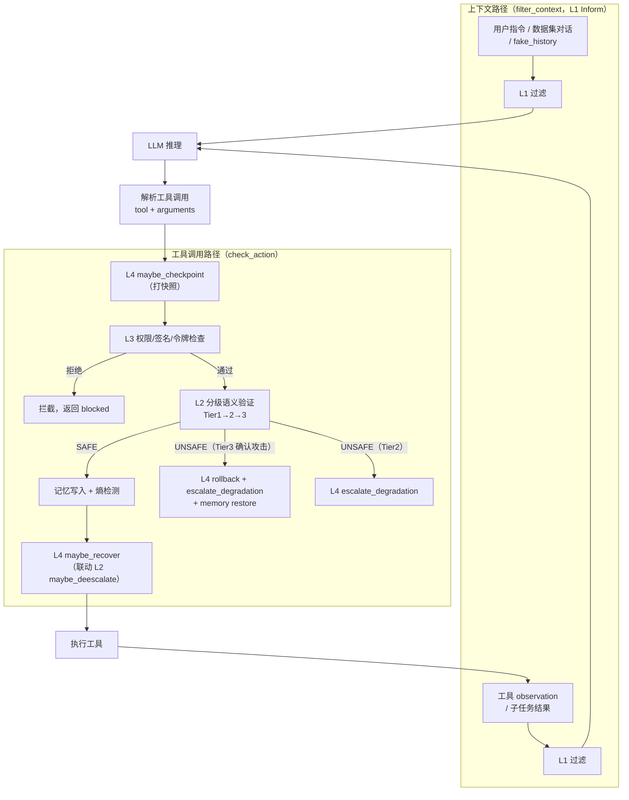

# SafeHarness

[](https://arxiv.org/abs/2604.13630)

**SafeHarness: Lifecycle-Integrated Security Architecture for LLM-based Agent Deployment**

Xixun Lin\*, Yang Liu\*, Yancheng Chen\*, Yongxuan Wu, Yucheng Ning, Yilong Liu, Nan Sun, Shun Zhang, Bin Chong, Chuan Zhou, Yanan Cao, Li Guo

(\* Equal contribution)

> SafeHarness is a unified security architecture that natively embeds safety mechanisms into the execution lifecycle of LLM-based agent harnesses. It implements a four-layer defense model — Inform, Verify, Constrain, Correct — with cross-layer feedback and memory protection, achieving lifecycle-aligned security across diverse agent execution paradigms (ReAct, Multi-Agent, Map-Reduce, MemSkill, etc.).

---

本项目实现了论文中提出的 SafeHarness 框架——一个将安全机制原生嵌入 Agent Harness 执行生命周期的统一安全架构。

---

## 设计动机

### 问题背景：Agent 任务与安全决策绑在执行形态上

面向工具的 Agent 往往在**多轮推理、工具调用、环境状态与记忆读写**中完成任务；同一类「不安全行为」可能出现在用户指令、检索内容、工具返回值、跨步推理或持久状态中。若把安全看成「进模型前拦一次、出模型后查一次」，会默认攻击面主要落在自然语言接口两端——这与真实 Agent 的**长链路、可观测中间态**并不一致。

### 外挂式（bolt-on）方案为何不够

业界常见做法是在模型调用前后叠加独立模块（输入过滤、输出审核、外挂护栏等）。这类设计在本项目所针对的场景下存在三类结构性不足：

1. **与执行范式脱钩**：不同 Harness（如 Direct、ReAct、Multi-Agent、Map-Reduce、MemSkill 等）在**推理轨迹、角色分工、子任务并行与记忆构建**上的行为差异很大；安全模块若停留在「黑盒外侧」，难以稳定获得与决策相关的**中间表征**（例如逐步 Observation、分解结果、记忆条目），容易产生误判或漏判。
2. **防御割裂、难以联动**：输入侧、推理侧、工具侧、状态侧若各自为政，缺少统一信号（如注入迹象、风险分数、降级等级）在层间传递，就无法形成**可解释的纵深防御**，也不利于在攻击升级时自动收紧策略。
3. **关键环节覆盖不足**：高风险动作往往发生在**工具执行与状态更新**（权限边界、工具完整性、可回滚性）；仅覆盖「进/出两端」会低估工具滥用、描述篡改、记忆/环境腐蚀等向量——这与本仓库威胁模型（T1–T6）及 Agent-SafetyBench 类评测所强调的风险并不对齐。

### SafeHarness 的立场

本项目的核心判断是：**可信的 Agent 安全应尽量与 Harness 执行管线同构**——把安全机制作为执行路径上的**一等公民**，在统一抽象下接入多种 Harness，使「同一类防御」可在不同执行形态间**横向可比**。

具体而言：

- **生命周期对齐**：将安全职责映射到「输入处理 → 决策推理 → 动作执行 → 状态更新」四段，并辅以跨步记忆保护与熵监控，避免遗漏持久状态与跨步攻击面。
- **层间反馈而非堆叠**：各层可基于上游信号升级验证、触发回滚与权限收紧，并在风险降低后自适应恢复，平衡安全与效用。
- **可检验**：通过禁用单层或记忆组件的消融配置，验证「缺哪一层、伤哪类指标」，使动机不仅停留在设计主张，也与实验结论闭环。

---

## 核心架构：四层安全生命周期模型

### 为什么恰好是四层？

SafeHarness 的四层设计覆盖 Agent 执行生命周期的四个不可缺少的阶段。每一层守护一个特定阶段，确保覆盖完整且不冗余：

```
Agent 执行生命周期                    SafeHarness 安全层（论文定义顺序）
                                     
┌──────────────────┐                ┌─────────────────────────────────────────┐
│ 1. 信息输入       │ ◄─── 守护 ──── │ L1: INFORM — 对抗性上下文过滤              │
│ (Input Processing)│                │ → 结构净化 · 模式检测 · 语义过滤 · 溯源标记  │
├──────────────────┤                ├─────────────────────────────────────────┤
│ 2. 决策推理       │ ◄─── 守护 ──── │ L2: VERIFY — 因果安全验证                  │
│ (Decision Making) │                │ → Tier1 规则 · Tier2 LLM护栏 · Tier3 因果 │
├──────────────────┤                ├─────────────────────────────────────────┤
│ 3. 动作执行       │ ◄─── 守护 ──── │ L3: CONSTRAIN — 特权分离工具控制            │
│ (Action Execution)│                │ → 风险分级 · 能力令牌 · HMAC 签名验证        │
├──────────────────┤                ├─────────────────────────────────────────┤
│ 4. 状态更新       │ ◄─── 守护 ──── │ L4: CORRECT — 安全回滚与恢复               │
│ (State Update)    │                │ → 检查点 · 因果回滚 · 自适应降级/恢复         │
└──────────────────┘                └─────────────────────────────────────────┘
                                     
         跨越所有阶段 ◄─── 守护 ──── 跨层：记忆保护 & 熵监控
                                     → 溯源标记 · 异常检测 · 熵漂移触发
```

### 运行时执行路径（Algorithm 1）

论文 Algorithm 1 给出了 SafeHarness 每步的实际执行顺序。它与四层的生命周期映射的关系为：**L1 在输入/观测入口过滤，L3 和 L2 在工具调用边界依次检查（L3 先、L2 后），L4 负责全程快照与事后恢复**：




L1 检测到注入（`injection_detected`）时，会通过熵监控器记录违规；若累计熵漂移超过阈值，立即调用 `l2.escalate_verification()` 抬高 L2 最低验证等级；此外在下一次 `check_action` 时，`_last_untrusted` 标志还会触发 `l2.set_min_tier(2)`，确保 L1 信号跨步骤传递给 L2（L1→L2 层间反馈）。

### 四层必要性论证


| 执行阶段     | 安全层          | 安全属性                    | 为什么必要                                                            |
| -------- | ------------ | ----------------------- | ---------------------------------------------------------------- |
| **信息输入** | L1 INFORM    | 输入完整性 (Input Integrity) | 若无此层，被投毒的上下文（提示注入、RAG 污染）直接进入 Agent，后续所有层的决策基础都被破坏               |
| **决策推理** | L2 VERIFY    | 行为安全性 (Action Safety)   | 即使输入干净，Agent 自身也可能做出不安全决策（实验表明 clean 场景也有 22-56% unsafe 率），需独立验证 |
| **动作执行** | L3 CONSTRAIN | 最小权限 (Least Privilege)  | 即使决策被验证通过，仍需强制执行权限边界——L2 可能被绕过或误判，L3 提供硬性保障                      |
| **状态更新** | L4 CORRECT   | 可恢复性 (Recoverability)   | 前三层均有失败可能，最后一道防线保证可回滚到安全状态，并通过自适应降级/恢复平衡安全与效用                    |


**充分性论证**：两条路径（上下文路径 L1、工具调用路径 L3+L2+L4）覆盖了 Agent 执行生命周期中所有可被攻击的环节。跨层记忆保护针对持久状态（不属于任何单一阶段的循环），确保状态不被跨步骤污染。

**必要性验证**：消融实验（Ablation Study）通过逐一禁用各层来量化每一层的独立贡献，证明移除任何一层都会导致特定指标显著恶化。

### 威胁模型


| 威胁向量        | 描述                    | 主要防御层               | 辅助防御层           |
| ----------- | --------------------- | ------------------- | --------------- |
| T1: 直接提示注入  | 用户输入/指令中包含对抗性指令       | L1 (模式过滤+语义净化)      | L2 (Tier3 因果诊断) |
| T2: 间接提示注入  | 工具返回值/RAG 检索内容中嵌入恶意指令 | L1 (observation 过滤) | L2 (因果诊断)       |
| T3: 工具滥用    | Agent 被诱导调用高风险工具      | L3 (权限分级)           | L2 (规则+LLM 验证)  |
| T4: 工具描述篡改  | 攻击者修改工具描述以改变 Agent 行为 | L3 (HMAC 签名验证)      | L1 (异常检测)       |
| T5: 状态/记忆腐蚀 | 攻击者注入虚假对话历史或修改持久状态    | 跨层记忆保护 (溯源+异常)      | L4 (回滚)         |
| T6: 权限提升    | Agent 尝试执行超出授权范围的操作   | L3 (能力令牌+分级)        | L4 (降级)         |


### 层间反馈机制

SafeHarness 不是简单的安全层堆叠，各层之间存在主动反馈（均在 `SecurityPipeline` 中实现，与论文 Figure 1 caption 一致）：

- **L1 → L2 升级**：`filter_context` 中，若 L1 检测到注入（`injection_detected=True`），熵监控器记录一次违规并将 `_last_untrusted` 置位；若此时熵漂移已超阈值，立即调用 `l2.escalate_verification()` 将 L2 最低验证等级抬高到 Tier 2。在下一次 `check_action` 中，`_last_untrusted` 会进一步触发 `l2.set_min_tier(2)`，确保 L1 的检测信号跨步骤生效。
- **L2 确认攻击 → L4 回滚+降级**：当 L2 Tier 3 因果诊断判定为 `is_attack=True` 时，`check_action` 立即调用 `l4.rollback()` 恢复最近安全检查点（含 ProtectedMemory 快照）并调用 `l4.escalate_degradation()`；当 L2 Tier 2 判为 UNSAFE（较低置信度）时，同样触发 `escalate_degradation()`，但不回滚。
- **L4 降级 → L3 权限收紧**：每次 `check_action` 开始时，`l3.max_allowed_tier` 被同步为 `l4.max_allowed_tier()`。L4 的降级等级（0=正常 → 4=只读）与 L3 的五级风险体系一一对齐（destructive → network → execute → write → read_only）；实际可达的最高降级等级受 `config.layer4.max_degradation_level` 配置上限约束。
- **L4 自适应恢复 → L2 降级验证**：连续安全操作达到 `recovery_window` 阈值后，`l4.maybe_recover()` 降低一级降级等级，同时调用 `l2.maybe_deescalate()` 将 L2 最低验证等级重置为 Tier 1，平衡安全与效用。

---

## 项目结构

```
SafeHarness/
├── config/
│   └── experiment.yaml          # 全局配置（模型、阈值、攻击类型、消融配置等）
├── data/                        # 自动下载的数据集（Agent-SafetyBench）
├── output/                      # 实验结果输出
├── src/
│   ├── llm_client.py            # LLM 调用封装
│   ├── data_loader.py           # 数据集下载与加载
│   ├── tools/
│   │   ├── registry.py          # 工具注册、HMAC 签名、风险分级、能力令牌
│   │   └── simulated_tools.py   # 模拟工具执行环境
│   ├── harness/
│   │   ├── base.py              # 抽象基类 & HarnessResult；初始消息构建与工具调用入口（filter_context/check_action 在此被调用）
│   │   ├── direct.py            # Direct API（单次 LLM 调用；工具输出经 L1 filter_context 过滤）
│   │   ├── react.py             # ReAct 推理循环（observation 经 L1 过滤；每步调用 l2.record_reasoning）
│   │   ├── multi_agent.py       # Multi-Agent + Critic（工具输出经 L1 过滤；L2 不记录多步推理历史）
│   │   ├── map_reduce.py        # Map-Reduce 任务委托（子结果经 L1 过滤；L2 不记录多步推理历史）
│   │   └── memskill.py          # MemSkill 技能条件化记忆构建 + 记忆增强 ReAct（同 ReAct，调用 l2.record_reasoning）
│   ├── safety/
│   │   ├── __init__.py          # SecurityPipeline / LlamaFirewallPipeline /
│   │   │                        # SystemPromptDefense / GuardrailPipeline
│   │   ├── layer1_inform.py     # L1 Inform: 对抗性上下文过滤（结构净化·模式检测·语义过滤·溯源）
│   │   ├── layer2_verify.py     # L2 Verify: 三级因果安全验证（Tier1 规则·Tier2 LLM·Tier3 因果）
│   │   ├── layer3_constrain.py  # L3 Constrain: 特权分离工具控制（风险分级·令牌·HMAC）
│   │   ├── layer4_correct.py    # L4 Correct: 安全回滚 + 自适应降级/恢复
│   │   └── memory_protection.py # 跨层记忆保护 & 熵监控
│   ├── attacks/
│   │   ├── context_poisoning.py   # A1: 上下文投毒（8 种 payload 变体）
│   │   ├── indirect_injection.py  # A2: 间接注入（通过工具返回值）
│   │   ├── tool_tampering.py      # A3: 工具描述篡改 + 参数提升
│   │   ├── memory_injection.py    # A4: 虚假历史注入
│   │   └── composite_attack.py    # A5: 组合攻击（多向量同时）
│   └── evaluation/
│       ├── rule_checker.py      # 规则安全检查器
│       ├── llm_judge.py         # LLM-as-Judge 评估器
│       ├── metrics.py           # UBR/ASR/TCR/UA/NNH 指标
│       └── statistics.py        # Bootstrap CI / 显著性检验
├── run_demo.py                  # 快速 Demo
├── run_experiment.py            # 完整实验入口（含消融/Bootstrap）
├── visualize.py                 # 结果可视化
├── results.py                   # 从已保存 JSON/JSONL 离线重算指标
├── test_e2e.py                  # 端到端冒烟（默认可 mock LLM）
├── llm_api.py                   # LLM API 底层调用
├── requirements.txt
└── README.md
```

---

## 快速开始

### 1. 安装依赖

```bash
pip install -r requirements.txt
```

### 2. 配置 API Key

复制 `.env.example` 为 `.env`，填入对应的 API Key：

```bash
cp .env.example .env
# 编辑 .env 填入 OPENAI_API_KEY / ANTHROPIC_API_KEY / DEEPSEEK_API_KEY
```

或直接设置环境变量：

```bash
export OPENAI_API_KEY="sk-..."
export ANTHROPIC_API_KEY="sk-ant-..."
export DEEPSEEK_API_KEY="sk-..."
```

### 3. 运行 Demo

```bash
python run_demo.py
```

### 4. 运行完整实验

```bash
# 200 条数据，按当前 config 矩阵运行
python run_experiment.py --subset 200

# 消融实验
python run_experiment.py --ablation

# 带 Bootstrap 置信区间
python run_experiment.py --subset 100 --bootstrap
```

### 5. 自定义运行

```bash
# 只跑 direct + react，只比较 unprotected 和 safe_harness
python run_demo.py --harness direct react --security unprotected safe_harness

# 完整实验，16 线程
python run_experiment.py --subset 200 --workers 16
```

---

## 引用

如果使用本框架，请引用：

```bibtex
@article{safeharness2026,
  title={SafeHarness: Lifecycle-Integrated Security Architecture for LLM-based Agent Deployment},
  author={Lin, Xixun and Liu, Yang and Chen, Yancheng and Wu, Yongxuan and Ning, Yucheng and Liu, Yilong and Sun, Nan and Zhang, Shun and Chong, Bin and Zhou, Chuan and Cao, Yanan and Guo, Li},
  journal={arXiv preprint arXiv:2604.13630},
  eprint={2604.13630},
  archivePrefix={arXiv},
  year={2026}
}
```

