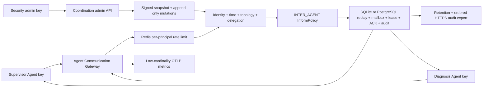

# Agent Communication Gateway

## Status and boundary

The Agent Communication Gateway is the first enforced SafeHarness boundary for
explicit Agent-to-Agent messages. It is an alpha reference: the HTTP protocol,
identity checks, topology, delegation rules, content inspection, mailbox leases,
replay state, ACK, signed durable coordination state, and administration API are
implemented. A shared PostgreSQL mailbox path, Redis distributed rate limiting,
low-cardinality telemetry, scheduled retention, and optional ordered HTTPS audit
export are also implemented. Workload-to-Agent certificate binding and real
multi-replica failover validation are not yet complete.



The API key is mapped server-side to `(tenant_id, agent_id)`. Message-body
identity cannot override that mapping. Every topology edge is denied unless the
trusted control plane explicitly permits its source, target, and message kind.

## Enforcement order

For `POST /v1/messages/send`:

1. Authenticate the Bearer key to one tenant/Agent and normalize the route.
2. Consume the shared per-principal Redis rate-limit bucket. Exhaustion returns
   `429`; limiter failure returns an audited `503` rather than bypassing the limit.
3. Parse versioned strict JSON; reject duplicate keys, unknown fields, invalid
   identifiers, oversized content/metadata, and timestamps without a timezone.
4. Compare the authenticated tenant/Agent with the message sender.
5. Enforce creation-time skew, expiry, and a maximum ten-minute message TTL.
6. Require registered active Agents and an explicit topology edge.
7. For `DELEGATE`, require a non-revoked, unexpired grant bound to grantor,
   grantee, session, run, accepted capabilities, and a message-use limit.
8. Run `EventKind.INTER_AGENT` through the configured SafeHarness inspector.
9. Atomically consume the message ID and delegation use, enqueue the inspected
   content, and append minimized audit. Any state or audit failure denies send.

Receive atomically claims pending messages with a one-second-to-ten-minute lease. The
gateway inspects leased content again before returning it. ACK must present the
current recipient-bound message and lease IDs; a successful ACK clears raw
content, metadata, and requested capabilities while retaining hashes and state.
ACK retry with the same lease is idempotent.

## HTTP API

Message and health routes require `Authorization: Bearer <Agent-specific key>`.
Administration routes require a separate admin key bound server-side to an actor.
The two key sets are required to be unique and cannot authorize each other's routes.

| Route | Purpose | Success |
| --- | --- | --- |
| `GET /health` | Writable authoritative-state readiness | `200` |
| `POST /v1/messages/send` | Inspect and enqueue one message | `202` |
| `POST /v1/messages/receive` | Atomically lease up to 100 messages | `200` |
| `POST /v1/messages/ack` | Acknowledge and scrub one current lease | `200` |

The durable administration surface is available only when the application uses
`PersistentCoordinationControlPlane`:

| Route | Purpose |
| --- | --- |
| `GET /v1/admin/coordination` | Read the verified version, signature, and policy metadata |
| `POST /v1/admin/agents/register` | Register an Agent |
| `POST /v1/admin/agents/active` | Activate or deactivate an Agent |
| `POST /v1/admin/agents/quarantine` | Quarantine an Agent inline |
| `POST /v1/admin/agents/restore` | Restore a quarantined Agent |
| `POST /v1/admin/topology` | Create or replace one topology edge |
| `POST /v1/admin/topology/remove` | Remove one topology edge |
| `POST /v1/admin/delegations` | Issue a bounded delegation |
| `POST /v1/admin/delegations/revoke` | Revoke a delegation inline |

Administration payloads use exact fields. Unknown fields, duplicate JSON keys,
unknown targets, invalid scopes, and stale optimistic versions fail closed. The
audit actor comes from the authenticated admin-key mapping, not request JSON.

The wire protocol is `safeharness-agent-communication.v1`. Use
`RemoteAgentCommunicationClient`; it disables redirects so an API key is not
forwarded and verifies every returned lease belongs to its configured
tenant/Agent.

## NOC demo

Create independent example secrets for both Agents, the admin API, and the
coordination-state HMAC chain:

```powershell
Copy-Item config/communication.env.example config/communication.env
```

Start the gateway:

```powershell
$env:PYTHONPATH = "src;."
python -m examples.langgraph_noc.communication_gateway
```

SQLite is the local default. To use the shared PostgreSQL communication store,
run schema migration with a migration identity, then configure the gateway's
runtime identity separately:

```powershell
$env:SAFEHARNESS_COMMUNICATION_POSTGRES_DSN = `
  "postgresql://migration-role:password@db/safeharness"
$env:SAFEHARNESS_COMMUNICATION_RUNTIME_ROLE = "communication_writer"
$env:SAFEHARNESS_COMMUNICATION_READER_ROLE = "communication_reader"
$env:SAFEHARNESS_COMMUNICATION_RETENTION_ROLE = "communication_retention"
safeharness-communication-init

$env:SAFEHARNESS_COMMUNICATION_BACKEND = "postgres"
$env:SAFEHARNESS_COMMUNICATION_POSTGRES_DSN = `
  "postgresql://communication-writer:password@db/safeharness"
```

Do not set `SAFEHARNESS_COMMUNICATION_POSTGRES_INITIALIZE=true` for a normal
gateway runtime. That flag is only a local-development escape hatch; production
migrations must use a separately privileged identity.

Configure the LLM URL, key, and model in `config/llm.env`, then run the outer LangGraph in
another terminal:

```powershell
$env:PYTHONPATH = "src;."
python -m examples.langgraph_noc.multi_agent `
  "Analyze alarms and packet-loss risk for NE-WH-OLT-01."
```

The graph is:

```text
supervisor_guard -> supervisor_send(DELEGATE + QUERY)
  -> diagnosis_receive -> diagnosis_execute -> diagnosis_send(RESULT)
  -> supervisor_receive -> final output guard
```

The convenience runner hosts both clients in one process so it can be tried in
two terminals. That is not process isolation. A production deployment must run
Supervisor and Diagnosis as separate workloads and inject only the workload's
own API key.

Run the container smoke profile with separately generated values added to
`config/deployment.env`:

```powershell
docker compose --env-file config/deployment.env -f deploy/compose/compose.yaml `
  --profile communication-test up --build --abort-on-container-exit `
  --exit-code-from communication-smoke-test communication-smoke-test
```

The profile requires distinct Supervisor, Diagnosis, coordination-signing, and admin
secrets. `communication-data-init` prepares the named SQLite volume for the non-root
gateway; the smoke container mounts that volume read-only and performs its final WAL
inspection with an immutable SQLite connection. The profile's test containers and volume
can be removed after the run without affecting the other staging services.

## API-key rotation

Each Agent and administrative actor can temporarily bind both a current key and one
previous key. Use the corresponding optional
`SAFEHARNESS_COMMUNICATION_*_PREVIOUS_API_KEY` setting only for a bounded rotation:

1. Deploy the new key as the current key and the old key as the previous key.
2. Switch the Agent or administration client to the new current key.
3. Verify that no client still uses the old key, then clear the previous-key setting.
4. Roll the gateway again so the old key is no longer accepted.

All current, previous, admin, Agent, and coordination-signing secrets must be globally
distinct. The Compose profile injects previous keys only into the gateway, not its demo
clients. Configuration is loaded at process startup; this is not dynamic secret-manager
reload, so both adding and removing a previous key require a restart or rolling deployment.

## Persisted data

SQLite stores message identifiers as SHA-256 fingerprints in replay/audit
records, content SHA-256, message state, lease state, bounded delivery attempts,
and minimized audit details. Raw API keys are never stored. Raw content exists
in the mailbox only until ACK and is never copied into communication audit.
Database triggers reject audit updates and deletes.

`PostgreSQLCommunicationStore` provides the same protocol contract for shared
state. Send keeps replay consumption, the bounded delegation counter, mailbox
insert, and minimized audit in one transaction. Receive selects available rows
with `FOR UPDATE SKIP LOCKED`, so concurrent replicas cannot lease the same
message. ACK locks one recipient-bound row before validating the lease and
scrubbing content. A dedicated retention role can run `purge_expired`; audit is
never deleted by that operation. This implementation has unit-level SQL and
cross-instance contract coverage, but no real multi-replica failover or capacity
evidence is claimed yet.

The same database can also store the current coordination snapshot and an
append-only mutation chain. Every version covers the canonical snapshot,
previous signature, operation, authenticated actor, and timestamp with HMAC-SHA256.
Startup and authorization verify the complete chain; tampering or rollback makes
the policy dependency unavailable. API keys, message content, tool arguments, and
credentials are not part of the snapshot or mutation log.

`PostgreSQLCoordinationStore` implements the same signed state contract with
row locking and optimistic version checks. Initialize its schema and role grants
using `safeharness-coordination-init`. The PostgreSQL path is a reference backend;
real multi-replica failover has not yet been validated.

## Rate limiting, telemetry, retention, and audit export

Set `SAFEHARNESS_COMMUNICATION_RATE_LIMIT_REDIS_URL` to enable the shared
fixed-window limiter. `SAFEHARNESS_COMMUNICATION_RATE_LIMIT_REQUESTS` and
`SAFEHARNESS_COMMUNICATION_RATE_LIMIT_WINDOW_SECONDS` control a bounded request
count and window. Redis stores only a SHA-256 bucket digest plus a window number.
The `safeharness_communication` ACL identity is limited to
`safeharness:communication-rate:*` and the `INCR`, absolute-expiry, transaction,
and health commands needed by the implementation.

The communication gateway emits the same content-free request dimensions as the
tool gateway under `safeharness_communication_gateway_*`: normalized route,
method, response status, bounded error code, and duration. Tenant/Agent IDs,
request IDs, message bodies, metadata, keys, DSNs, and arbitrary paths are not
metric attributes. The checked-in Prometheus rules alert on absent telemetry,
5xx rate, limiter unavailability, and sustained throttling.

Run one bounded PostgreSQL cleanup cycle with the dedicated retention identity:

```powershell
$env:SAFEHARNESS_COMMUNICATION_RETENTION_DSN = `
  "postgresql://retention-role:password@db/safeharness"
safeharness-communication-maintain --once --retention-hours 168
```

The long-running command defaults to a five-minute interval. Retention accepts
one hour through 90 days and deletes expired mailbox/replay rows only; it cannot
delete communication audit. The Compose service is isolated under the
`communication-maintenance` profile and persists only its export cursor volume.

Optional off-site export additionally requires a reader DSN, an HTTPS URL, and
an independent Bearer token. Records are minimized and ordered by
`(occurred_at, record_id)`. Each POST has a deterministic idempotency key, and the
local cursor advances atomically only after a 2xx receiver response. SafeHarness
does not implement the receiver; append-only/WORM storage, availability,
retention, and restoration evidence must be supplied by the operator.

## Residual risks and production work

- SQLite serializes local writers. It is restart-persistent, not shared-state HA.
- PostgreSQL shared mailbox/replay/lease/delegation/audit code is implemented,
  but real PostgreSQL multi-replica failover, capacity, RPO/RTO, and long-running
  retention validation remain open.
- Registering a new Agent persists its policy identity but does not mint or store
  an API key. The gateway's authenticated key mapping still comes from deployment
  configuration; onboarding a new workload requires the enterprise identity/key
  lifecycle and usually a controlled gateway reload.
- The admin API currently shares the gateway listener. Production deployment
  should put it on a separately authenticated management network and add approval
  workflow, dynamic secret reload, and enterprise IAM binding.
- TLS client certificates can be required, but certificate identity is not yet
  mapped to a specific Agent. API-key identity remains authoritative.
- LangGraph and OpenAI Agents adapters now guard their explicitly wrapped
  sub-Agent/handoff and memory paths, but a process can still bypass this boundary
  through direct sockets, shared memory, files, an alternate broker, or any
  unwrapped framework primitive unless platform policy prohibits those paths.
- The combined demo holds two Agent keys and must not be used as the production
  process model.
- Scheduled PostgreSQL cleanup, Redis rate limiting, OpenTelemetry, and HTTPS
  minimized-audit export are implemented reference paths. Long-running validation,
  receiver-side immutability, certificate/signing-key rotation, and operational
  archive/restoration policy remain deployment work.
- Quarantine is inline and effective for new sends/receives. No post-hoc trust
  score or cascade analysis is claimed as real-time isolation.
